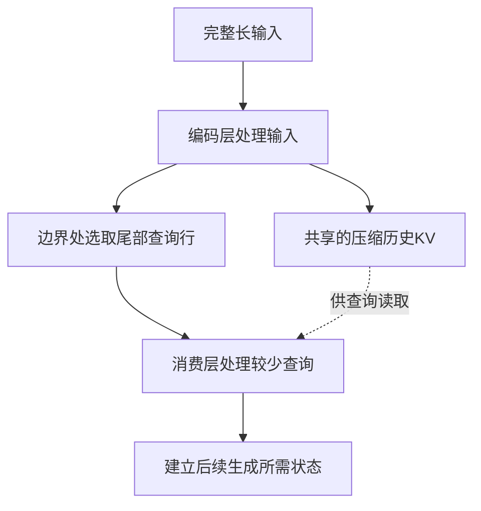
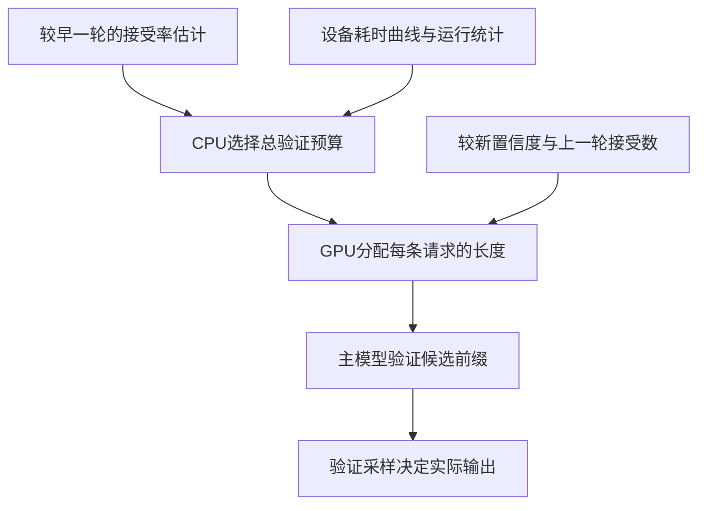
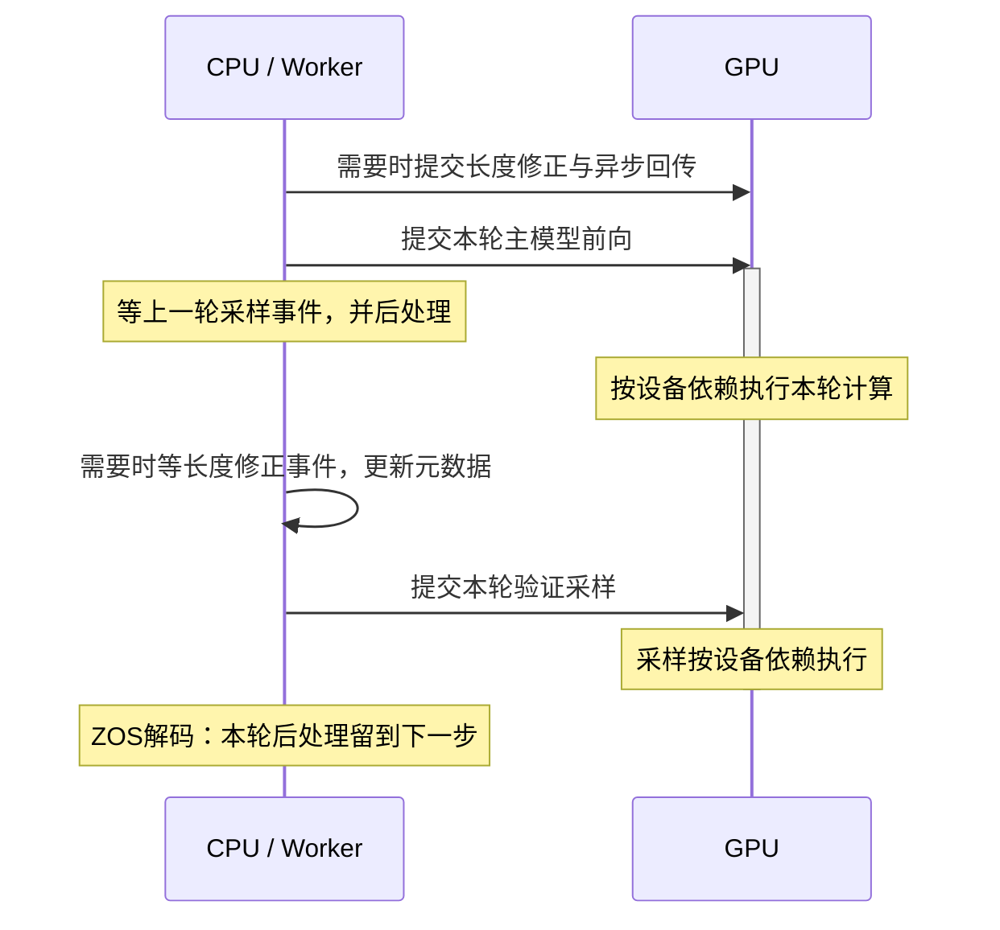

# DeepInfer为什么快？从源码拆解DeepSeek的推理系统

<!-- reading-stats -->约 5,400 字 · 阅读约 18 分钟（含源码与图解）<!-- /reading-stats -->

Juju Radar · 深度解读 · 2026 年 10 月 22 日

网页版补充了关键源码与交互图示。代码均节选自固定提交 `9bd9cf2`，仅去掉最外层缩进；图示说明数据流与执行依赖，不表示实测耗时。

一个模型能够回答什么问题，和一张GPU能够同时服务多少人，是两道不同的题。

DeepSeek公开DeepInfer后，最容易吸引注意的是性能图里的高吞吐。但要理解这些数字，得接着问：模型这轮究竟少算了什么？数据还要搬多少次？GPU在哪些地方等CPU，又在哪些地方等其他GPU？

这次把[DeepInfer源码固定到一个提交](https://github.com/deepseek-ai/DeepInfer/tree/9bd9cf243fc53ef9afbf8f04d391d989117d6ab9)，沿主要执行路径读下来，可以看到五种具体办法：利用模型结构减少部分预填充；把验证计算留给更可能接受的草稿；让CPU与GPU并行推进；把专家通信和计算融合；用冗余专家缓解热点。线上系统还借助跨请求缓存复用，避免反复读同一份长历史。

它们解决的是不同的瓶颈，适用条件也不同。尤其值得注意的是，公开跑分中有均衡路由和草稿接受率的设定；YOCO的有限重放则包含近似。理解这些条件，才能判断设计能借鉴到哪里，而不只是记住一个很大的token/s数字。

<!-- source-id: deepinfer-code -->

读下面的源码时，可以先用这张表分清它们各自解决什么问题。

| 机制 | 节省的主要开销 | 发挥作用的条件 |
| --- | --- | --- |
| YOCO有限重放 | 消费层处理长输入的计算 | 跨层共享KV；需评估截断近似 |
| DSpark动态验证 | 低收益草稿的验证计算 | 接受率、并发与设备耗时曲线 |
| CPU/GPU重叠 | GPU等待CPU后处理的空档 | 跨轮状态与长度修正正确 |
| Mega MoE融合 | 专家通信与算子之间的等待 | 对应互联、精度与内核路径 |
| EPLB专家重排 | 热点设备拖慢其他设备 | 副本显存、搬运成本与热点稳定性 |


## 先看懂性能图：每卡吞吐和单个用户速度不是一回事

一次大模型请求通常分成两个阶段。预填充（prefill）先读输入、建立后续计算要用的状态；解码（decode）再不断产生新token。长输入的预填充有大量可并行计算，解码则要一轮轮往前走，低并发时很容易受读权重、读缓存和通信开销限制。

README中的解码图，把“每个用户出字的速度”放在横轴，把“每张GPU合计输出多少token”放在纵轴。图上每卡吞吐接近2.6万token/s的点，对应每个数据并行位置同时有256条请求，单用户速度约100token/s。并发降到8条时，单用户速度更高，合计吞吐却低很多。两种“快”并不能混用。

这条曲线还有明确条件：64张SM100处于一个高速互联域，13万左右的上下文，固定3个草稿token，并按75%的接受率换算为每轮3.25个有效token。它不是一次覆盖任意业务、任意硬件的速度承诺。

读[benchmark初始化代码](https://github.com/deepseek-ai/DeepInfer/blob/9bd9cf243fc53ef9afbf8f04d391d989117d6ab9/examples/benchmark.py#L152-L169)还能发现，脚本启用了强制均衡路由；文本请求由随机token构造。[绘图代码](https://github.com/deepseek-ai/DeepInfer/blob/9bd9cf243fc53ef9afbf8f04d391d989117d6ab9/examples/sweep/plot_pareto.py#L58-L68)则用外部传入的接受率，把实测执行步频换成token速度。因此，它更适合回答“受控负载下，这套引擎能把设备用到什么程度”。真实业务中的路由偏斜、实际草稿接受率、排队和跨请求缓存命中，需要另外测。

## 第一处大幅省算：解码层不必把长输入重新跑到底

最值得仔细读的是YOCO相关路径。这里的前提是V4.1已经采用了跨层共享结构：前面的编码层处理输入，后续消费层可以使用共享的压缩KV。KV可以理解为注意力计算留下的键和值，后面生成时用它们查阅历史，不必从原始输入重新计算全部中间结果。

但消费层还有滑动窗口注意力（SWA），要保留最近一段历史的局部状态。逐层精确恢复这份状态，仍然需要往前追溯一段计算。[官方部署说明](https://github.com/deepseek-ai/DeepInfer/blob/9bd9cf243fc53ef9afbf8f04d391d989117d6ab9/doc/inference_deployment_qa.md)给出的例子是：精确重建要让末尾2560个token经过20个解码层；有限重放改为只重算最后128个token，说明中称这能接近减半总预填充计算。

在[模型层循环](https://github.com/deepseek-ai/DeepInfer/blob/9bd9cf243fc53ef9afbf8f04d391d989117d6ab9/deepinfer/model_executor/models/deepseek.py#L181-L221)里，代码走到第一个YOCO消费层时，会把元数据切换成压缩后的查询布局；[边界处理函数](https://github.com/deepseek-ai/DeepInfer/blob/9bd9cf243fc53ef9afbf8f04d391d989117d6ab9/deepinfer/model_executor/models/v4_modules/yoco.py#L50-L76)再真正选出需要保留的隐藏状态行。后续层处理的查询位置因此减少，连带少做这些位置上的注意力和专家计算。它并非只给结果加一个遮罩、算完再扔掉。

决定工作量有没有真正减少的，是 `yoco_boundary_compact` 中这几行。节选自上面链接的 `yoco.py` 第65—76行：

```python
# 1
if input_metadata.yoco_cp_contrib_index is None:
    return gather(x, input_metadata.yoco_consumer_query_indices)
# 2.a
x2d = x.flatten(1) if x.ndim > 2 else x
contrib = gather(x2d, input_metadata.yoco_cp_contrib_index)
with userbuffer.cp_session():
    # 2.b
    gathered = userbuffer.cp.all_gather(contrib)()
    # 2.c
    out = gather(gathered, input_metadata.yoco_cp_boundary_index)
return out.view(-1, *x.shape[1:])
```

没有启用上下文并行时，`gather` 直接按 `yoco_consumer_query_indices` 从 `x` 的第一维选行，返回的隐藏状态已经缩短。启用上下文并行时，后半段先在各设备上取出保留位置，汇集后再按新的分片布局选行。两条路径都在改变后续层实际处理的张量，而不只是给完整计算加一个遮罩。

下面把“少算查询”与“保留历史”分开画。实线表示本次查询计算，虚线表示读取共享KV；窗口长度仅用于解释机制。



图1 · YOCO有限重放示意。历史KV仍可访问，减少的是消费层的查询工作量。

这里很容易产生一个误会：只重放尾部，不意味着模型只看最后128个token。共享的压缩KV仍然提供历史信息路径；被缩短的是消费层恢复局部SWA状态所需的计算。README示例保留140个位置，是为了覆盖128的滑窗及回退等额外余量，不能把它解释成整个模型的上下文长度。

**这项省算包含近似，需要单独检查质量。** 重放起点附近看不到此前的完整局部状态，因此不能仅凭“窗口有限”就认定输出完全不变。仓库的[YOCO验证脚本](https://github.com/deepseek-ai/DeepInfer/blob/9bd9cf243fc53ef9afbf8f04d391d989117d6ab9/examples/yoco/README.md)比较的是mask与compact：前者保留全部查询行、只改变可见范围；后者在相同可见范围下移除多余行。两者对齐能说明compact实现没有偏离既定截断语义，却不能自动证明它与关闭截断的完整计算质量相同。

此外，“接近减半计算”也不直接等于“用户首字等待减半”。分词、排队、缓存读取、设备通信和其他层的开销仍在；短输入可省的部分也更少。这首先是一项依赖特定模型结构的优化，不能直接套给所有Transformer。

## 第二处省算：草稿先写五个，主模型未必值得验证五个

普通解码通常一轮产生一个token。投机解码先让较便宜的草稿模块提出若干候选，再由主模型并行验证；连续通过的候选可以一并输出，减少主模型往返轮数。

但验证本身要花计算。某条请求的第一、第二个草稿很可靠，第五个经常被拒绝，固定每轮验证五个就可能多花钱、少得到有效输出。DeepInfer使用的DSpark为草稿预测接受概率，再决定每条请求分多少验证预算。

关键逻辑在[C++验证调度器](https://github.com/deepseek-ai/DeepInfer/blob/9bd9cf243fc53ef9afbf8f04d391d989117d6ab9/csrc/engine/mtp_varlen.hpp#L152-L265)。它会累计“预计能够产出的token数”，同时查询对应批大小的运行时间曲线，并加入运行中观测到的前向和采样耗时修正。目标是提高预计有效token数与预计耗时的比值，所以更大的验证批次不一定胜出。

这个取舍可以直接在 `mtp_varlen.hpp` 第242—248行看到：

```cpp
const auto &[graph_size, baseline_ms] = _decode_perf_curve[cur_bsz_idx];
const double time_ms = baseline_ms + slope_ms * graph_size + sampler_ms;
const double cur_throughput = cur_expected / time_ms;
if (cur_throughput > best_throughput) {
    best_throughput = cur_throughput;
    best_bsz = cur_bsz;
}
```

`cur_expected` 是这一批预计能产生的有效token数；`time_ms` 包含启动时测得的耗时基线、运行中修正项和采样时间。外层循环逐步加入候选，每加一个，就用这个比值重新比较。它并不假定草稿越长越划算：如果新增计算跨过了更昂贵的执行批次，而预计接受数涨得很少，预算就应该停在更小的位置。


后面位置的收益还取决于前面的候选能否通过。[GPU分配内核](https://github.com/deepseek-ai/DeepInfer/blob/9bd9cf243fc53ef9afbf8f04d391d989117d6ab9/deepinfer/model_executor/layers/tilelang_ops/cuda/schedule_mtp_varlen.py)先把逐位置概率做累乘，再按收益分配额外预算。举个纯说明性的例子：前两个位置各有90%的条件接受率，第二个位置能随前缀一起到达的概率就是81%。不能把后面的高分候选跳过前面的拒绝，单独拿出来输出。

置信度在这里决定的是“哪些候选值得送去验证”，最终接受或拒绝仍由主模型的验证采样完成。它不会因为草稿自报有信心，就直接把候选当成答案。



图2 · 异步解码中的预算与验证依赖。CPU选择总预算使用N−2轮的估计；GPU利用较新的状态分配并修正长度。图中是依赖关系，各步骤在跨轮流水中执行，不代表每轮都顺序等待整张图跑完。


公开部署表也说明了负载依赖。以下是官方估算值的重新计算，单位均为token/s/rank，比较对象是固定验证五个草稿，并非整个DeepInfer相对其他框架的提升：

| 每rank并发请求 | 固定长度验证 | 动态长度验证 | 相对变化 |
| --- | --- | --- | --- |
| 16 | 4891 | 4816 | −1.5% |
| 60 | 13730 | 14466 | +5.4% |
| 72 | 14962 | 15961 | +6.7% |

在生产所述的每rank约60条并发附近，少验证低收益草稿有明显好处；并发很低时，额外调度与批次变化也可能让它更慢。把4%—7%直接叠加到任何请求上，会丢掉这项设计最重要的条件。

## 第三处提速：让CPU准备下一轮，GPU继续算这一轮

即使GPU上的算子很快，CPU调度也可能让它一轮轮空等。最直接的执行方式是：CPU排好批次，GPU计算并采样，把结果传回CPU，再更新请求、组织下一批。每步都短的时候，这些空档会反复出现。

DeepInfer的[Worker执行顺序](https://github.com/deepseek-ai/DeepInfer/blob/9bd9cf243fc53ef9afbf8f04d391d989117d6ab9/deepinfer/worker/worker.py#L85-L185)把上一轮的后处理延后：先发起本轮主模型执行，再处理上一轮已经完成的结果，然后发起本轮采样。CPU可以在GPU工作时准备后续步骤。所谓零开销批调度，追求的是把CPU工作从GPU的等待时间里隐藏掉，并非CPU逻辑真的不耗时间。

`worker.py` 第143—152行保留了一处很有说明力的同步点。此前本轮 `execute_main_model` 已被调用，接下来才处理上一轮：

```python
# 2. post process prev step
request_outputs = self._post_process_step(self.prev_step_state)

# 3. sample curr step（先用 d2h 回来的 seqlens_q 修正 CPU 侧元数据）
if correction is not None:
    if correction.d2h_evt is not None:
        correction.d2h_evt.synchronize()
    scheduler_outputs.update_metadata_for_sampling_zos(
        seq_metadata_list, correction.seqlens_q_cpu, correction.metadata_zos.remap_cpu, self.nextn
    )
```

第一行真正处理的是 `prev_step_state`，不是刚发起的本轮结果。下面的 `synchronize()` 也值得保留在节选中：只要本轮采样需要修正后的CPU元数据，就仍须等相应设备回传事件；重叠没有取消数据依赖。代码随后才发起本轮 `execute_sample`。



图3 · Worker的跨轮执行示意。CPU后处理与GPU前向可以重叠。长度修正回传安排在本轮前向之前，等待它不等于等待整轮前向完成；上一轮采样事件也仍须同步。图中间距不代表实际耗时。

更难的是，提前排下一轮时，上一轮究竟接受了几个草稿，可能还没回到CPU。代码为此保留跨轮状态：CPU先确定总预算，GPU利用上一轮仍在设备上的接受数量与置信度，修正各请求的查询长度和历史长度，再进入后续计算。不能用还没拿到的真实长度直接组织一轮执行，也不能每次都等CPU回传，抵消整个重叠设计。

这也是多项优化不能孤立相加的原因。动态验证会改变每条请求的长度，异步调度又让这些长度晚一轮到达；两套机制必须共同处理依赖、事件与缓冲区寿命。高性能运行时的工作，有相当一部分是在保证“并行以后仍然算对”。

## 第四处提速：把专家之间的搬运和计算接起来

混合专家模型（MoE）每个token只用少量专家，但这些专家分布在不同GPU上。一次专家计算至少要做三件事：把token送到负责的设备，执行专家网络，再把结果送回并汇总。若各阶段独立完成、逐次等待，通信和中间结果处理会占掉不少时间。

在[MoE执行路径](https://github.com/deepseek-ai/DeepInfer/blob/9bd9cf243fc53ef9afbf8f04d391d989117d6ab9/deepinfer/model_executor/models/v4_modules/mlp.py#L528-L572)中，满足硬件和精度条件时会选择Mega MoE。它把专家分发、两次线性计算、激活函数和结果合并放进一个融合内核，重叠高速互联通信与张量核计算。继续读固定版本的[DeepGEMM实现](https://github.com/deepseek-ai/DeepGEMM/blob/1fc9c66975ee322d628b3288534ca0e9ce12a64d/deep_gemm/include/deep_gemm/impls/sm100_fp8_fp4_mega_moe.cuh#L341-L444)，能看到不同warp分别负责搬运、计算相关流水与收尾，以及用来协调它们的缓冲区和屏障。

这里省下的主要是阶段之间的等待、反复发起内核的开销，以及部分中间数据处理。前面的量化结果还可以尽量按后续算子需要的布局写入共享缓冲区，避免算完以后再换一次格式。具体计算路径支持FP8激活搭配FP4或FP8权重等组合；低精度减少的数据量，只有与对应算子和布局接好，才更容易变成吞吐收益。

上层调用也能看出它如何把这些环节接到一起。`mlp.py` 第549—559行把两组专家权重、共享缓冲区和激活配置交给同一个入口：

```python
self.mega_moe_func(
    out,
    self._weight_and_sf(self.gate_up_proj_weight),
    self._weight_and_sf(self.down_proj_weight),
    sym_buffer,
    **self.shared_weights_kwargs,
    cumulative_local_expert_recv_stats=self._eplb_layer().expert_count,
    activation=self.activation_type,
    activation_clamp=self.swiglu_clamp_value,
    fast_math=True,
)
```

`gate_up_proj_weight` 对应专家网络前半段投影，`down_proj_weight` 对应后半段投影；`sym_buffer` 承接通信与计算所用的共享数据。单看这个调用只能确认融合路径的入口，搬运与计算如何分工仍要继续读DeepGEMM内核。`cumulative_local_expert_recv_stats` 还把实际接收统计交给EPLB使用：融合执行与后续热点调整在这里接上了，但统计本身不等于完成了负载均衡。


这些优化也有清楚的硬件门槛。当前代码选择Mega MoE时，会检查专家组是否处于相应高速互联域；SM100上的通信与计算实现，并不能无条件迁移到普通以太网连接的若干显卡上。官方采用更宽的专家并行，也是在给定互联与批量条件下，争取更少的单步权重流量和更有效率的矩阵计算。

因此，看到64卡配置比8卡配置的每卡表现更好，不能只归结为“卡多所以快”。专家如何分布、每个专家能凑到多少token、设备要读多少权重，以及通信能否被计算覆盖，才是中间的因果链。

## 第五处提速：多放几份热门专家，减少大家等最忙那张卡

更宽的专家并行容易遇到负载偏斜。模型总共有很多专家，并不意味着请求会均匀选择它们；某几个专家特别忙，就可能把其他已经完成的GPU一起拖住。

[EPLB策略源码](https://github.com/deepseek-ai/DeepInfer/blob/9bd9cf243fc53ef9afbf8f04d391d989117d6ab9/deepinfer/model_executor/eplb/policy.py#L83-L140)分两步处理。先根据一段时间内的token统计，为高收益的热点专家增加物理副本；再把专家和副本分到各个GPU。它考虑各历史批次的峰值负载，而非只按专家数量平均切分。重排的是已经训练好的专家权重及其物理位置，不是在推理中重新训练专家。

本次实际在CPU运行了这段策略函数。给六个逻辑专家设定一批人为负载：120、90、5、5、5、5；允许八个物理槽位，四个位置各放两个专家。代码把最忙的两个专家各复制一次，得到的预计负载是65、65、50、50，总工作量仍为230。这个小例子只验证副本与放置怎样变化，没有测量GPU耗时，也不包含通信和搬权重成本。

冗余副本消耗显存，重新放置要搬权重，历史热点也可能突然变化。要提高整体吞吐，减少的等待必须大于这些代价。因此线上系统按窗口统计、间隔更新，而不会每来一个token就重新摆一遍专家。把这一机制接好，宽专家并行的潜力才不至于被少数热点吞掉。

## 还有一大块效率，来自开源引擎之外

多轮Agent往往反复带着相同代码、说明和工具历史发请求。若每次都重新预填充，GPU会把很多已经做过的工作再做一遍。DeepSeek的生产架构用专门的KV存储集群保存这些结果，让不同预填充节点都能读取此前的前缀。

它解决了一个实际冲突：把请求固定路由到保存缓存的机器，容易撞上负载不均；只往空闲机器发，又可能丢掉复用机会。共享存储使计算节点不必因为缓存位置被绑住，存储容量与计算容量也能分别扩缩。

但这里需要区分完整生产系统与当前开源内容。仓库已有设备侧缓存结构和状态恢复等执行接口，长期KV存储服务、完整的请求负载均衡，以及视觉编码、预填充、解码分离所需的整套线上部署，并没有全部包含在开源包中。部署文档里三天或七天的缓存保留、线上达到理想均衡离线吞吐约80%等描述，都是团队的生产系统自报，下载仓库不会自动获得这些条件。

阶段分离本身也不神秘：视觉编码、预填充和解码的负载不同，分开以后可以各自配机器、扩容量、控制首字延迟或后续出字间隔。代价是阶段之间要传状态、做路由，并处理故障。对于请求量小、上下文复用少的部署，这套集群组织的收益与成本，可能与DeepSeek的大规模服务相差很远。

## 源码给出的答案，比一个加速倍率更有用

DeepInfer的效率来自一组能相互配合的选择。模型结构允许共享KV，运行时才有机会跳过部分消费层计算；草稿置信度与设备时间曲线结合，才知道少验证哪些候选值得；异步执行要修正跨轮长度，才能把CPU空档隐藏掉；MoE融合与专家重排则分别处理通信流水和热点等待。

这些设计不能直接加成一个总倍率。少做预填充主要帮助长输入；动态验证依赖接受率与并发；融合依赖互联和低精度路径；缓存复用取决于历史是否重复、能否及时取回。即便模型权重相同，换一组请求和机器，主导瓶颈也会变。

要进一步判断“比现有部署快多少”，最有用的下一步是一套分层对照：同一批真实请求、同一精度和硬件，分别切换有限重放、动态验证、异步调度与专家融合，记录吞吐、首字延迟、后续延迟及任务质量。关闭强制均衡，使用实际草稿接受率，并把缓存未命中与命中分开报告。这样才能知道收益落在了哪一层，也知道为它付出了什么。

本文完成的是固定提交的主要热路径阅读、一次CPU策略验证和公开估算的算术复核，没有运行SM100或昇腾950上的模型推理。当前证据足以解释多项优化为什么可能有效，还不足以替任何具体业务承诺一个实测倍率。

## 原始资料

点击文末“阅读原文”查看固定版本源码、部署说明与benchmark入口。三张交互图由Juju Radar据源码绘制，均为机制示意，不是官方性能测量。源码节选来自DeepSeek的DeepInfer仓库，依原仓库Apache-2.0许可标示来源；文件与行号见各节链接。本文由AI辅助阅读源码、整理和撰写，发布前由作者审核。
