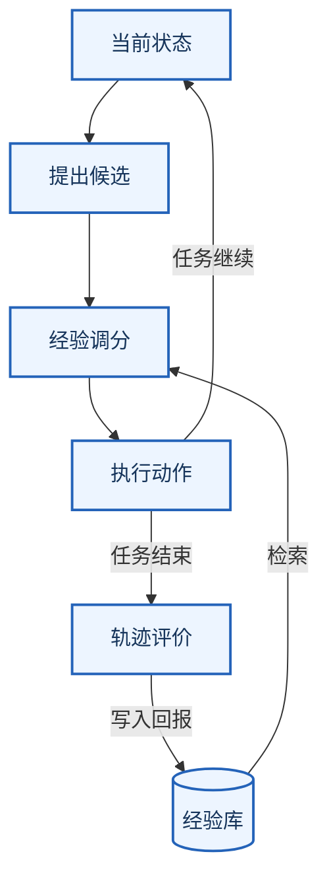

# JitRL：不改模型权重，Agent如何从经验中学习

<!-- reading-stats -->约 4,200 字 · 阅读约 14 分钟<!-- /reading-stats -->

Juju Radar · 深度解读 · 2026 年 10 月 25 日

<!-- source-id: jitrl-paper -->

一个网页Agent刚刚找错了菜单。任务结束后，它能写出反思：下次应该先进入客户评价页面，再筛选目标商品。下一次运行时，它却又点进了原来的菜单。

保存了经验，为什么还会重复犯错？因为系统能把“上次错在哪”写进上下文，却不一定能让这段经验改变模型当下最倾向采取的动作。

新加坡国立大学团队提出的[JitRL](https://arxiv.org/abs/2601.18510)（Just-In-Time Reinforcement Learning，即时强化学习），关注的就是这一步。它给冻结的模型接上一个经验库，记录过去在什么状态下做过什么、后来得到多少回报，再用这些记录调整当前的动作选择。初稿提交于今年1月，本文依据9月修订的版本和公开源码展开。

这项研究有两个层面值得一起读：方法上，它让外部记忆承担一部分价值估计；实现上，当前代码采用的加分方式，与论文的闭式更新公式仍有差别。理解前一个层面，才能知道它为什么可能有效；核对后一个层面，才能判断哪些理论结论适用于实际程序。

## 先区分两件事：模型记住了什么，系统选择了什么

模型可以知道一个网站通常怎样操作，却不熟悉这家公司的具体后台。页面名字、菜单位置、按钮行为，都可能与训练中见过的习惯不同。对这类任务，反复执行的价值很大：走过一次的有效路径，往往可以帮助下一次。

JitRL把可变的学习状态放在模型外部。模型继续负责理解任务、读取页面和提出候选动作；经验库负责保存带有结果信息的记录；控制程序在执行前，把历史回报纳入选择。随着记录增加，同一个模型在相近状态下可能走出不同的路径。

因此，权重冻结不妨碍整个Agent系统适应环境。变化发生在由模型、记忆和选择规则共同组成的策略里。这里的“无需训练”，指不通过梯度更新模型参数，仍然要付出任务尝试、模型调用、评价和记忆检索的成本。

这种做法也给调试留下了一个具体入口。如果一个动作突然被选中，可以检查哪些历史记录给它加了分，而不必只猜模型为什么这么回答。错误经验是否匹配了错误页面、回报是否被打高，都能成为可追查的问题。

## 把一段经历，变成下一步可用的回报

假设一个Agent在客户后台完成了一次筛选任务。它依次打开菜单、设置条件、提交查询，最后找到了正确记录。

只保存“任务成功”还不够。系统需要判断，哪些步骤起了作用，哪些只是绕路。JitRL的[方法部分](https://arxiv.org/html/2601.18510v4#S4)让LLM评估器在任务结束后查看完整轨迹，为各步骤分配奖励，再计算折扣回报：当前步骤可以获得后续收益的一部分，距离越远，权重通常越小。

这能把“先设置条件，后面才查对”的收益传回前面的动作。最终写入记忆的是三项：状态、动作、从这一步往后的回报估计。这里的回报经过评估器归因，并非环境直接提供了每一步绝对正确的标签；如果评估器把绕路当成贡献，错误就会一起进入记忆。

下一次遇到相似页面时，系统检索一组相关记录。所有邻近记录的平均回报，作为当前状态的比较基线；其中采取过某个候选动作的记录，再单独求平均，估计这个动作的价值。两者相减，就是优势值：

```text
优势值 = 该动作的历史平均回报 - 邻域平均回报
```

它回答的是一个局部问题：根据这批相似经历，这个动作比通常的选择好多少？历史里没出现过的动作，则有一定概率得到探索奖励，避免系统完全锁死在旧路径中。



图：Juju Radar据论文与源码绘制的机制示意。更新经验库发生在任务评价之后，不表示每走一步都训练一次模型。

## 关键在于，经验进入了动作选择

如果只是把几段历史贴进提示，模型仍然需要自行决定是否采纳。JitRL进一步把经验转换为数值，直接参与候选动作之间的比较。

论文给出的更新可以简写为：

```text
新动作概率 ∝ 原动作概率 × exp(β × 优势值)
```

回报比邻域平均值更高的动作得到上调，低于平均值的动作受到压低。β控制调整强度：经验的影响越大，就越可能推翻模型原来的偏好。

这个形式来自一个带KL惩罚的策略优化问题。系统希望偏向高回报动作，同时约束新策略偏离原策略的程度；给定优势估计后，这个优化问题有闭式解，不需要为了求出这次调整而跑一轮梯度训练。

它还处理了模型这一轮漏报有效动作的情况。[候选补充代码](https://github.com/liushiliushi/JitRL/blob/143d22185d95fbf633a0befe6861d5e8b732543b/WebArena/memory_agents/jitrl_agent.py#L257-L283)会从召回记忆中加入历史动作，但要先把它映射到当前页面可执行的元素。找不到对应元素，就跳过。这让过去走通的操作有机会重新参与比较，同时也限定了它的能力来源：模型和经验都没提出过的操作，不会凭一个优势公式自动出现。

## 真正难的是：两次经历，究竟有多像

做回报平均只需要几行算术，决定哪些经验能够放在一起平均，才是更难的部分。

[网页记忆的召回实现](https://github.com/liushiliushi/JitRL/blob/143d22185d95fbf633a0befe6861d5e8b732543b/WebArena/memory_agents/utils/cross_episode_memory.py#L480-L536)先匹配规范化后的URL，再按任务目标的文本相似度筛选，之后比较操作历史。论文也会把客户编辑页里的具体编号抽象掉，让不同客户的同类页面能够共享经验。

这样可以学到界面的一般用法：编辑客户资料时应该先打开哪一类菜单。但抽象得太多，也可能把关键区别抹掉。两个页面拥有相同结构，目标客户、权限、当前筛选条件却可能不同；前一次有效的动作，放到后一次就未必合适。

文字冒险游戏同样如此。房间描述相似，不代表手里拿着同样的道具，也不代表某扇门已经打开。把这些状态混在一起，得到的回报平均值可能很稳定，却稳定地指向错误动作。

所以，记忆量增长并不自动带来更好的决策。对实际部署者，优先要验证的是：检索出来的经历，在当前任务中是否仍然适用。比较时需要保留哪些信息，比选一个更复杂的向量数据库更早决定结果。

## 实验说明了什么：同类任务反复执行，确实能受益

[WebArena主实验](https://arxiv.org/html/2601.18510v4#S5)使用Gemini-2.5-flash，每个任务依次尝试5次，并在过程中积累经验。作者报告：

| 方法 | 5次尝试平均成功率 | 第5次成功率 |
|---|---:|---:|
| 固定策略Static | 35.63% | 36.30% |
| 原始历史记忆Memory | 41.36% | 43.00% |
| EvoTest | 39.24% | 42.49% |
| JitRL | 46.98% | 51.35% |

JitRL相对固定策略提高了11.35个百分点，相对原始历史记忆提高5.62个百分点。这支持一个具体结论：在这些网页任务中，把经验用于动作价值调整，比固定运行或单纯保存原始历史更有效。

这组成绩包含重复尝试后的适应。46.98%不是首次遇到陌生任务的单次成功率，第5次的51.35%也不能当作一次执行就能达到的表现。它更贴近“用同一套Agent反复做同类工作，会怎样变化”的问题。

论文还做了相同召回信息下的比较：把经验追加进提示，或用来更新动作分数。Admin上的结果分别为48.35%和52.31%，Reddit为54.57%和57.64%。这个对照比只与无记忆系统比较更有说服力，因为它试图分离“拿到了经验”和“怎样使用经验”的贡献；仍需结合具体管线和任务理解。

## “便宜30多倍还更强”，需要拆开看

主实验里，JitRL与昂贵的权重更新方法存在模型和适应方式的差异。更适合回答公平比较问题的，是论文v4补充的同模型对照。

在同一个Llama-3.1-70B骨干上，使用相同训练任务，评估相同的WebArena-Lite保留集，测试阶段不再积累新经验，[附录J.1](https://arxiv.org/html/2601.18510v4)报告：

| 方法 | 成功率 | 报告成本 |
|---|---:|---:|
| 监督微调SFT | 23.00% | 约640美元 |
| JitRL | 40.88% | 约200美元 |
| WebRL | 46.06% | 约9,900美元 |

在这个设置里，JitRL明显降低了适应成本，也超过SFT，但没有超过WebRL。对不方便部署训练集群、希望利用少量执行经验的团队，这样的结果仍然有实际价值；只是选择要落在可接受的成功率与投入上，不能把不同设置中的最好数字拼到一起。

主文成本表中的JitRL约290美元，WebRL约9,900美元，前者主要按API词元计费，后者是训练硬件费用估算。“30多倍”由这类账单比较而来，不是推理速度快30多倍，也不是相同准确率下每次任务调用都便宜30多倍。

同一张表中，Static约200美元。记忆、评价和适应需要额外调用，JitRL本身并非零开销。它主要省下的是参数训练，而不是把所有执行成本都消除了。

## 读源码时，还有一处不能略过的差异

论文的闭式更新，如果写在logit空间，是原始logit加上β乘优势值。logit是概率归一化之前的分数，不能随意与概率互换。

但固定提交143d221的[WebArena评分代码，第378行](https://github.com/liushiliushi/JitRL/blob/143d22185d95fbf633a0befe6861d5e8b732543b/WebArena/memory_agents/jitrl_agent.py#L376-L389)，实际执行的是：

```python
corrected_logprob = normalized_prob + 1 * normalized_advantage
```

沿[输入概率的获取路径](https://github.com/liushiliushi/JitRL/blob/143d22185d95fbf633a0befe6861d5e8b732543b/WebArena/memory_agents/jitrl_agent.py#L1017-L1062)往前看，token模式把API返回的logprob取指数，verbalized模式则把模型自报的置信度除以100。这里使用的量确实是概率或置信度，而非变量名所暗示的logprob。最后，程序[选择加分后最大的候选](https://github.com/liushiliushi/JitRL/blob/143d22185d95fbf633a0befe6861d5e8b732543b/WebArena/memory_agents/jitrl_agent.py#L1119-L1132)。Jericho实现也采用类似的概率加分，并增加随轮次变化的优势权重。

这会产生可观察的区别。用一个自拟的两动作例子：原概率为A占90%、B占10%，优势分别为−1和+1，β取1。若比较各方法最终最倾向的动作，得到：

| 更新方式 | A | B | 最大值对应动作 |
|---|---:|---:|---|
| 论文公式归一化后的概率 | 54.91% | 45.09% | A |
| 当前代码的加分得分 | −0.10 | 1.10 | B |

第二行是得分，不是概率。这个算术例子没有运行网页任务，但足以说明：两种规则可能选出不同动作，差异不只在变量名称上。

因此，当前公开主路径更接近一种经验加分的动作重排器。论文关于闭式解的最优性，不能未经说明就移到这版实现上。这也不能倒推出论文实验无效，或认定作者当时实验运行的就是当前提交；严谨复现需要先对齐方法定义、代码版本和实际配置。

## 哪些Agent值得试，哪些期待需要收住

反复操作同一类后台、经常遇到相近页面与工具的Agent，是较适合验证这条路线的对象。模型负责理解新任务，经验负责纠正本地环境中的习惯偏差。一次次执行积累的有效记录，可能比反复在提示里添加“注意不要再犯错”更容易变成稳定的行为变化。

前提是结果可以评价、状态能够匹配。若任务每次都完全不同，错误只能在很久以后发现，或关键状态难以用文本保留，历史回报就很难可靠地用于当前选择。能力也仍受候选集合约束：模型没有提出、经验里也没有的解法，价值重排通常帮不上忙。

理论上的收敛讨论还要求邻近状态的价值变化受控、回报估计的噪声没有系统偏差、经验能够覆盖相关状态和动作，以及历史策略与当前策略的偏离受到约束。真实业务不一定满足这些条件，尤其是自评分长期偏高、界面改版或流程权限改变之后。

更值得采用的验证方式，是保留同模型、同工具与相近预算的对照，分别测无记忆、提示记忆和显式动作修正；再用未参与记忆构建的新任务检查迁移。记录总调用费、完成率、失败重试和人工接管次数，也单独检查那些被记忆推翻的动作，究竟改对了多少。

JitRL提出了一个可继续研究的系统设计：模型参数之外，经验记录也可以承载学习，而且能通过明确的价值估计影响控制。它的意义在这条具体的数据与决策路径上。至于这条路径能否在某个真实Agent里稳定工作，仍要看状态表示、奖励归因和实现细节是否接得起来。

## 推荐阅读

先读论文第4节的方法，再看第5节的重复尝试协议和附录J的受控比较。准备复现时，对照本文固定版本的候选评分、概率获取与记忆召回路径，先确认自己实现的是哪一种更新规则，再讨论成功率与费用。

本文完成了论文v4、主要源码路径和数值反例的核对，没有运行完整WebArena或Jericho基准。流程图为据方法整理的机制示意，所有任务成绩与成本来自作者报告。

## 原始资料

点击文末“阅读原文”，可查看论文、固定版本源码和本期全部资料。

本文由AI辅助阅读、核验和撰写，公众号版本经作者审核后发布。

