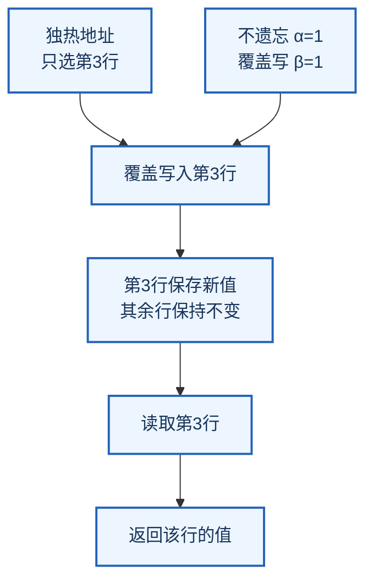
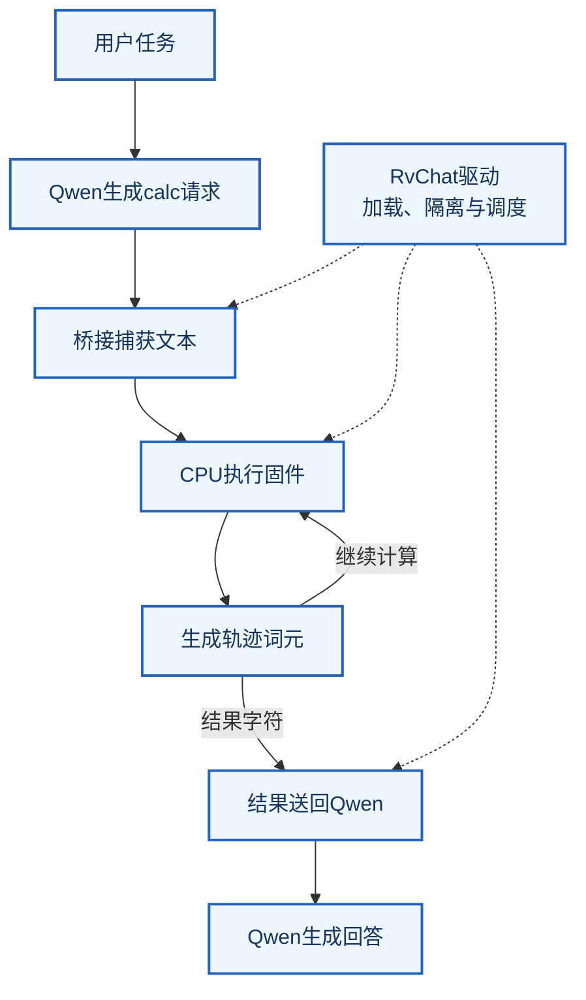

# Qwenputer：把CPU写进模型权重，究竟有什么用？

<!-- reading-stats -->约 4,900 字 · 阅读约 17 分钟<!-- /reading-stats -->

Juju Radar · 深度解读 · 2026 年 10 月 31 日

<!-- source-id: qwenputer-compiled-computer -->

面对一道长整数乘法，语言模型需要做两件事：决定怎样计算，再准确执行计算。它可能知道乘法规则，却仍在进位、符号或中间结果上出错。外接计算工具解决了后一个问题，也让我们很自然地把“理解任务”和“执行程序”放在两个系统里。

[Qwenputer](https://divagr.com/blog/qwenputer)尝试把这两部分接在同一个模型体系内。独立开发者Divyansh Agrawal在Qwen3.5-4B前加入一个由固定权重实现的RISC-V计算核心，用循环状态保存程序和数据。语言模型继续组织请求，计算部分按照预先规定的指令语义运行。

这篇解读依据作者10月22日的技术长文、公开源码，以及10月30日新增的NPU扩展。它是一项有实物代码的架构实验。最值得追问的，是精确计算怎样在神经网络结构里成立、它与原有模型怎样交接，以及这种安排究竟付出了什么代价。

## 一、先分清：权重保存机器规则，状态保存正在运行的程序

“把CPU写进权重”容易让人误解为：把一段Python程序背进模型，或者让模型学会扮演处理器。Qwenputer采用的路径更直接：用编译器计算出一组权重，让新增网络层实现寄存器读取、整数运算、分支判断和内存写入。

在[固定版本的核心实现](https://github.com/divagr18/qwenputer/blob/f07a0b2e38271454c4d455dc2b9bf78d3d399170/experimental/riscv/chipformer/rv/core.py)中，电路被分配到11个附加层。指令支持RV32IM，也就是32位整数RISC-V及乘除法扩展，另有Zba和大整数运算支持。这里的“CPU”指指令语义与状态转移规则，没有多造一块物理芯片；实际计算仍然由承载模型的硬件执行。

需要分开的还有两个存储位置。权重固定了这台机器“遇到某条指令该怎样处理”；程序、内存值、寄存器和程序计数器，主要放在运行时的循环状态里。运行另一段程序，通常是装入不同状态，而非重新训练或重写整套CPU权重。

它提供的空间也很具体：[设计文档](https://github.com/divagr18/qwenputer/blob/f07a0b2e38271454c4d455dc2b9bf78d3d399170/experimental/riscv/docs/rv32.md)中的普通RAM为32KB，另有128KB只读数据空间和256KB代码空间。这个规模足以承载一些小程序，与日常电脑上任意运行大型软件仍相距很远。

## 二、DeltaNet为什么能成为内存

Qwen3.5混合使用完整注意力与Gated DeltaNet。后者在处理新词元时，会更新一个固定形状的状态矩阵。它可以承载历史信息，但默认更新是连续的、带遗忘和混合的，不能直接当成每次都原样读写的地址表。

Qwenputer让专门用于计算的那些状态满足三个条件：遗忘系数为1，旧信息不衰减；写入强度为1，把目标位置完全替换；地址采用独热编码，也就是只有一个分量为1，其余为0，因此每次只选中一个位置。

在这三个条件下，忽略实现中的缩放，把状态矩阵写成“每行是一个地址”的方向，更新可以简化为：

```text
新状态 = 旧状态 + 地址向量 ×（新值 - 该地址的旧值）
```

假设地址向量只选第3行，括号里先减掉第3行旧值，再加上新值，其他行不会受影响。读取时也用只选第3行的查询向量，就能把这一行取出。一次更新需要处理的状态大小不随运行历史增长；可用地址数量则受预先分配的状态容量限制。



图：据方法整理的读写机制示意，第3行仅作教学例子，不表示实测容量。

精确性还有一层容易被略过的工程条件：状态中的数据采用受控的位值和缩放，激活函数、归一化和浮点舍入也要符合约定。把门设成1只是起点，不能据此推断任意语言模型的状态都能无误地保存任意实数。

## 三、代码怎样把“完全覆盖”变成权重

编译器的[权重生成代码，第236至239行](https://github.com/divagr18/qwenputer/blob/f07a0b2e38271454c4d455dc2b9bf78d3d399170/experimental/riscv/chipformer/q35/emit.py#L236-L239)给出一个很小但关键的例子。下方仅将长行换行：

```python
beta = (
    Expr({ONE: 128})
    if vhd.beta is None
    else (
        256 * vhd.beta
        - 128 * one
    )
)
row(beta, lay, bw[vh])
```

`Expr`描述一个线性表达式，`row`把它写到相应权重行。代码将逻辑上的写入开关映射为很大的正值或负值：在目标计算精度下，经过sigmoid后分别舍入为1或0，从而实现完整写入或禁止写入。它不是让模型在语言中回答“现在应该写内存”，而是把写入规则落实到网络计算。

更复杂的整数运算也被分解成类似的小电路，再排进有限层数。中间表示会检查数值能否落在允许的表示范围内、地址是否满足约束；生成器则把这些图节点转换为模型支持的注意力与前馈结构。[中间表示及数值约束](https://github.com/divagr18/qwenputer/blob/f07a0b2e38271454c4d455dc2b9bf78d3d399170/experimental/riscv/chipformer/q35/ir.py)才是“编译CPU”真正的工作量所在。

因此，这种确定性来自设计者给出的电路、指令规则和数值范围。它没有证明常规语言模型经过现有训练，就会自行发现同样的CPU结构；也没有把原模型所有推理都变成确定性程序执行。

## 四、不用重新训练，合并时仍要处理归一化和隔离

项目介绍强调保留Qwen原有权重。沿[模型合并代码](https://github.com/divagr18/qwenputer/blob/f07a0b2e38271454c4d455dc2b9bf78d3d399170/experimental/riscv/chipformer/rv/merge.py#L144-L175)看，准确的理解应是：不靠梯度后训练把底座教成CPU，原有语言计算尽量保留；导出文件中的所有数值并非逐位不动。

合并后的隐藏维度从2560扩到3968。输入、输出矩阵通过补零隔开原语言维度与计算维度，但归一化会对更多维度求平均。若不补偿，即使新增维度都是零，原有信号的缩放也会变化。下面两行取自同一个合并函数，省略了中间的循环：

```python
scale = (
    d0 / hidden
) ** 0.5
g = (
    (1.0 + w.float())
    * scale - 1.0
)
```

第一行算扩维后的比例；第二行按Qwen的零中心增益写法重标定归一化参数。这是为了抵消维度变化，仍会发生BF16舍入。普通文本与底座行为接近，需要测量，不能单靠“补零”保证。

此外，[隔离实现](https://github.com/divagr18/qwenputer/blob/f07a0b2e38271454c4d455dc2b9bf78d3d399170/experimental/riscv/chipformer/q35/mute.py)会在新增控制列写入权重，让计算轨迹经过原Qwen层时不继续改写它的语言状态；完整注意力部分还有根据文本查询统计构造的隔离处理。这里存在校准与布局工作，“无需训练CPU”不等于“无需任何合并工程”。

文档的保真检查也没有给出全输入等价保证：16个提示中，10个的贪心文本完全相同；平均输出分布差异接近两种基础推理内核之间的噪声水平。这个结果支持影响较小，不能扩写为所有对话都会逐字一致。

## 五、模型仍写工具调用，计算却由内部电路接手

语言模型已经熟悉工具调用的文本格式。Qwenputer沿用这个接口：Qwen输出`calc`请求，编译电路把请求文本捕获到缓冲区，运行算术固件，再输出结果文本。

这里仍有驱动程序。[`RvChat`的执行路径](https://github.com/divagr18/qwenputer/blob/f07a0b2e38271454c4d455dc2b9bf78d3d399170/experimental/riscv/chipformer/rv/chat.py#L324-L426)先处理提示，再把固件和机器状态装入计算层。计算轨迹词元走计算路径，普通文本交给Qwen；在加速路径中，Qwen自己的层不会逐个处理内部计算轨迹。

输出交接可从第422至426行看出。下方摘取相关两条语句，并对长行换行：

```python
ct = self.circuit_token(hc)
nxt = (
    ct if ct is not None
    else int(
        torch.argmax(
            logits[: self.v0]
        )
    )
)
```

`ct`表示电路是否掌握当前位置的输出权。若有电路结果，就由电路给出下一个词元；否则回到Qwen的普通词表预测。算术结果不会在这一步重新交给语言模型“猜一个相似数字”，但模型拿到正确结果后，仍可能在最终回答里误用它。



图：据`RvChat`整理的交接示意。内部计算跨多个步骤进行，不能把一条`calc`请求画成一次模型前向就结束。

这也解释了两个容易混淆的说法：算术不由外部Python解释器代答，但系统仍要靠宿主代码加载、调度和解码。模型可按标准架构加载，不代表普通`generate()`已经能够自动完成这整套交接。

## 六、CPU每次算对，题目为什么仍会做错

作者的算术比较通常每组40题，区分原Qwen无工具、内置计算与宿主工具三种条件。以大整数乘法为例，报告成绩分别为55%、97.5%和100%。这支持“给模型可靠的计算入口能显著改善算术”，没有显示内置方案稳定胜过外部工具。

更有解释价值的是失败记录。CPU已经给出正确数值后，Qwen仍出现过漏符号、继续做错一次减法，或围绕正确答案调用44次直到耗尽预算的情况。可以把错误分成三层：电路执行是否正确，固件接口是否表达了用户所需的算术语义，语言模型是否正确使用返回值。

固件版本的变化把这种区别展示得很清楚。旧版只允许最终结果是分数，不支持一些中间分数运算。复杂乘除那组里，1,040次调用有610次返回错误，内置计算最后只答对20/40。改为全过程精确有理数后，重跑得到40/40；对应宿主工具为39/40。

这里同时变了固件版本，部分运行的硬件、批量设置也不同，因此不能把20/40到40/40当成一次干净的模型能力消融。它揭示的是更实际的问题：底层计算没有出错，接口语义不合适，仍能让Agent反复重试并失败。

这也是源码比一张总分表更有用的地方。判断一个计算增强系统，除了看数字正确率，还应追查请求如何解析、什么输入会返回错误、错误后模型怎样恢复。

## 七、速度必须分执行路径，不能把轨迹词元当成普通文字

“CPU在模型里运行”没有免除模拟指令的成本。每条指令可能需要多个内部轨迹词元，长程序会反复更新状态。作者的三种运行方式也有不同开销：

| 路径 | 实际运行内容 | 作者报告的L4速度 |
|---|---|---:|
| HF计算层路径 | 使用模型中的计算层模块 | 约250个轨迹词元/秒 |
| Triton执行器 | 执行等价中间表示的电路运算 | 约3,200个轨迹词元/秒 |
| 新NPU融合执行器 | 进一步融合计算电路 | 约5,500个轨迹词元/秒 |

这些是不同版本与执行配置下的报告值，不是一组同条件硬件跑分。尤其是后两行，不能被解释为普通稠密Transformer前向天然就有这样的速度。

在Triton路径下，一次约1,300至3,000轨迹词元的`calc`调用，报告耗时约0.5至1秒；一整道复杂题还包含Qwen组织请求、等待返回、继续生成文字和可能的重复调用。芯片轨迹的吞吐，与用户最终收到答案的速度，需要分别计量。

文件大小也是成本的一部分。原合并模型的BF16检查点约18.7GB，许多位置是扩维产生的零填充。电路约百万个非零权重，不能据此认为整个模型只需几MB；普通加载格式仍要承载扩宽后的矩阵与词表。

## 八、最新NPU扩展：在模型里的CPU上，再跑一个小模型

10月30日出现的[Qwenputer-npu公开权重](https://huggingface.co/divagr1925/Qwenputer-npu)把实验再推了一步。它增加向量点积、权重基址和字节乘加指令，将一个26万参数的stories260K小语言模型，作为C程序放到内部CPU上执行。

关键区别在[该程序的实现说明](https://github.com/divagr18/qwenputer/blob/271723255803900de3cb92b4c6a4635d82a51f85/experimental/riscv/guests/stories260k/README.md)：小模型权重是加载进内存的数据，而非为这个小模型重新编译一台专用CPU。点积扩展一次处理多个低精度数值，减少逐条模拟的工作量。

但成本依然很高。普通C、int8版本每生成一个故事词元约需243万个轨迹词元；采用新指令与int4权重后，在报告的较后位置约需22.5万个。用约5,500轨迹词元/秒的融合执行器计算，约为41秒一个故事词元。

这里的41秒针对“内部CPU上运行的小模型”，不是Qwen本体的日常文字输出速度。低精度权重还经过了自蒸馏，作者展示的前60个输出词元与浮点模型一致，不等于所有输入、所有位置都数值等价。它验证的是一条可以进一步检查的程序执行路线，尚不能承担实用推理加速的结论。

## 九、什么已经有证据，什么还没有

Qwenputer提供了比概念演示更具体的检查入口：公开权重、编译器、参考机、指令测试与执行器可以相互对照。但不同测试的证明范围需要分开。

把参考执行轨迹逐个喂给电路，再检查下一步是否一致，能发现许多实现错误；它不能替代长时间自由运行，因为前者每一步都给了正确历史。自由运行、真实模型内核以及完整聊天任务，则分别检验误差累积、数值实现和调用策略。作者报告的长程无误差运行，不能与本文的小型检查合并为一次“已独立复现”。

本文复查了三组项目数学中间表示：内存读写、乘除余数、分支循环，共42个下一位置预测与项目参考机一致，并检查了内存更新和归一化补偿公式。没有下载完整检查点，也没有复现真实BF16/GPU内核或长程自由运行。这个结果支持文中对机制的解释，覆盖范围远小于完整系统验证。

功能范围也有一个具体细节：详细P3文档把MicroPython列为“独立核心和执行器已运行，尚未接进合并聊天模型”。因此，能运行算术固件、独立核心支持MicroPython、Qwen已经能任意编写并内部执行Python，这三件事不能互换。

此外，[Loom在4月的预印本](https://arxiv.org/abs/2604.08816)已经研究过用解析构造权重的循环Transformer执行C编译程序。Qwenputer的意义更适合放在现成混合语言模型的整合上：利用已有循环结构做精确内存，把电路和语言交互接起来，而非首次证明神经网络能执行程序。

## 它提供的研究价值：把“执行”拆成能追查的部件

Qwenputer让一种组合变得具体：语言模型负责把自然语言任务变成请求，编译电路负责按照固定规则执行，状态保存运行中的程序与数据。解释一次错误时，可以分别检查数值电路、固件语义、状态恢复和调用策略。

这种拆分比“模型数学更强了”更值得继续研究。它也给后续改进设定了明确问题：能否减少每条指令的轨迹步数，压缩零填充与执行开销，让模型学会少调用、正确处理错误，并在更多任务中保持原有语言表现。

对今天需要可靠算术或代码执行的产品，外部工具仍有成熟、便宜和易隔离的优势。Qwenputer目前提供的是一条可读源码、可逐层检查的整合路线。它的下一步说服力，会来自相同任务和预算下的完整比较：内置了多少确定计算，用户实际少等了多久，又有多少错误仍留在语言模型这一侧。

## 原始资料

点击文末“阅读原文”查看作者报告、固定版本源码、权重和背景论文。代码节选来自作者MIT许可仓库，保留文件与版本链接；图示由Juju Radar据方法和源码整理。本文由AI辅助检索、源码阅读、计算检查与编辑，公众号版本待审核。
