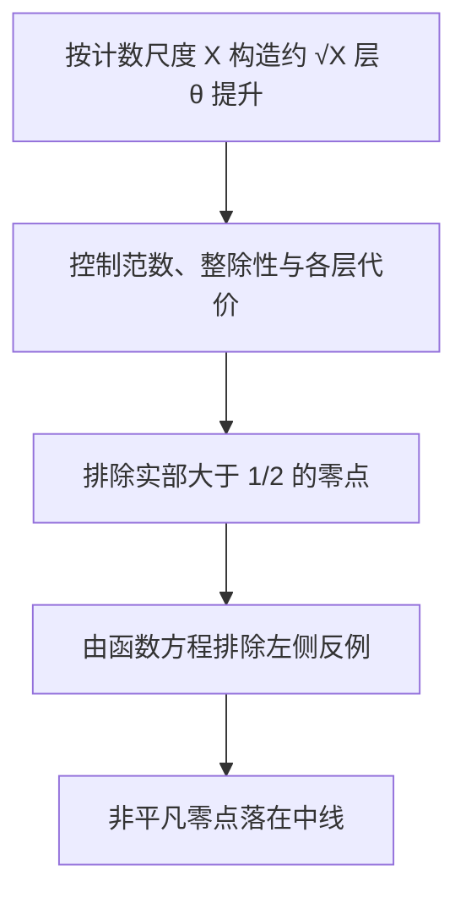

# 黎曼猜想的 Lean 证明里，Claude 的 √X 用在了哪里？

<!-- reading-stats -->约 2,900 字 · 阅读约 10 分钟<!-- /reading-stats -->

Juju Radar · 深度解读 · 2026 年 11 月 21 日

<!-- source-id: alpoge-claude-riemann -->

Levent Alpöge 公布与 Claude 合作的黎曼猜想证明后，他特意指出了一个平方根。作者说，当他们研究截至尺度 X 的加权素数和时，Claude 建议把一种叫作 **θ 提升**的变换串起来，链长取大约 √X。这个平方根在证明里量的是什么？[Alpöge 的四页说明](https://alpo.ge/remark.pdf)

可以从证明最后几行倒着看。源码先把整族狄利克雷 L 函数的零点排除在中线右侧，再用对称性排除左侧。平方根的选择发生在第一步的深处。那里需要积累一种类似「重数」的效果，同时控制每一层变换引入的代价。[证明入口与归约](https://github.com/CocoSgt/riemann-hypothesis-lean/blob/7cbf7a0c32fca1badf05931879a37c3f8a2b03b4/src/Supplements/Kernels/MainTheorems.lean#L1-L15)

## 一、为什么数素数会变成找零点

把横轴画成自然数，纵轴画成「到这里为止有多少个素数」。素数定理给出整条曲线的大致走向。黎曼猜想关心它会偏离理论估计多少。用对数积分作估计时，猜想给出的误差上限按 √x 乘以对数因子的量级增长，适用于所有足够大的 x。这里的 x 是数到哪里为止。[素数计数的等价表述](https://dlmf.nist.gov/27.12#E7)

ζ 函数把素数的乘法结构编码进一个复函数。通过显式公式，ζ 的非平凡零点会出现在加权素数计数的波动项里。粗略地说，实部为 β 的零点对应的项里含有 x 的 β 次方。实部越靠右，相应项就可能随 x 增长得越快。这解释了为什么复平面上的一条直线，会和整数里的素数误差有关。[克雷数学研究所的题目说明](https://www.claymath.org/millennium/Riemann-Hypothesis/) · [Bombieri 的数学说明](https://www.claymath.org/wp-content/uploads/2022/05/riemann.pdf)

这里有两个平方根。一个描述素数计数误差的尺度。另一个是 Claude 为辅助构造选的**变换次数**。两者都随计数尺度变化，各自出现在不同的数学步骤。

## 二、源码最后只需要排除右半边

假设 ζ 函数有一个非平凡零点，实部是 0.4。通过函数方程，可以在对称位置推出一个零点，它的实部是 0.6。这样一来，只要证明实部大于 0.5 的整个区域没有零点，左边的反例也就被排除了。所有非平凡零点只能落在实部等于 0.5 的线上。[Lean 的右半平面归约](https://github.com/CocoSgt/riemann-hypothesis-lean/blob/7cbf7a0c32fca1badf05931879a37c3f8a2b03b4/src/Formalism/GammaFactorNonvanishing/RhOfRight.lean#L1-L54)

源码把两步分得很清楚。**allChi** 是狄利克雷 L 函数整族的右半平面无零点定理。**rhOfAll** 把这个结论用到模数为 1 的特例，此时相应的 L 函数就是 ζ 函数。随后用函数方程完成经典黎曼猜想的归约。函数方程早已为人所知。新证明的主要工作，是把无零点的范围推进到整片右半平面，而且对所有狄利克雷特征成立。[经典猜想的特例归约](https://github.com/CocoSgt/riemann-hypothesis-lean/blob/7cbf7a0c32fca1badf05931879a37c3f8a2b03b4/src/Formalism/GammaFactorNonvanishing/CritLine.lean#L29-L32) · [正式命题](https://github.com/CocoSgt/riemann-hypothesis-lean/blob/7cbf7a0c32fca1badf05931879a37c3f8a2b03b4/src/Statements.lean#L1-L16)

## 三、Stepanov 的方法为什么要讲重数

在有限域里，算术发生在只有有限个元素的数系中。那里的类似问题，可以通过数曲线有多少个点来研究。Stepanov 方法会构造一个非零的辅助多项式，让需要计数的不同横坐标成为它的根，并且每个根至少有 m 重。于是多项式的次数给总根数设下上限。举个简化的例子，30 次多项式上，每个根如果至少有 5 重，满足要求的不同根最多 6 个。[Kowalski 讲义第 4.3 节](https://people.math.ethz.ch/~kowalski/exponential-sums-elementary.pdf#page=51)

「重数」可以从 x 和 x³ 看出来。两者在零点都等于零，x³ 在那里还多满足两阶导数为零。让目标点成为高重数的根，能把点数上限压得更低。不过，辅助多项式同时得保持非零，而且次数不能涨得比重数还快。原方法有专门的代数工具来同时满足这些约束。

Alpöge 受到这个办法启发。经典问题的对象是整数和素数，有限域里构造辅助多项式的条件无法直接照搬。作者提纲记录了几条尝试，包括把素数及其幂放进一个加权和，再利用与零点相联的显式公式，寻找能控制这项波动的量。[作者提纲第 3 页](https://alpo.ge/remark.pdf#page=3)

## 四、Claude 的 √X 到底选在了哪里

θ 提升是一种在不同对称结构之间传递自守形式的变换。自守形式可以先理解成满足特定对称规则的函数。提纲里的构造把这些变换串起来，让对象在一系列酉群之间逐级传递。Alpöge 将一串 m 次提升描述为能积累重数 m 的效果。这让有限域方法所依赖的高重数构造，在整数问题里有了一个新的对应物。[作者提纲第 4 页](https://alpo.ge/remark.pdf#page=4)

**Claude 提议的是，当加权素数和研究到尺度 X 时，链长 m 取在 √X 的数量级。** 如果只看数量级，X 从一百万扩大到一亿，建议的链长会从一千量级增加到一万量级。这里数的是构造里的变换次数。层数控制能积累多少重数，也决定后面要处理多少代价。太短，积累的效果可能不够。加长以后，又得估计变换后对象的大小、相关量的整除性，以及高阶项怎样抵消。作者的时间线甚至记下了一个中间障碍。逐次计入提升的代价后，初步估计会卡在 2/3。提纲随后列出了额外的平均和整结构计算，才到最后的广义黎曼猜想。[作者提纲第 4 页第 8 至 20 项](https://alpo.ge/remark.pdf#page=4)

所以，把这称作「神来之笔」有清楚的出处。Alpöge 说，他先把有限域里的类比与另一条思路接起来，并引导研究方向。至于把链长取在平方根尺度，他明确把这个提议归给 Claude。公开提纲给出了它解决的构造问题，也列出了之后还要做的工作。至于 √X 怎样由各项估计推导出来、其他尺度能不能走通，四页提纲没有展开。读者目前能追踪的是提议出现在哪一步，以及后续证明用了哪些工具让整条路线成立。[原始说明](https://alpo.ge/remark.pdf) · [无零点定理的源码入口](https://github.com/CocoSgt/riemann-hypothesis-lean/blob/7cbf7a0c32fca1badf05931879a37c3f8a2b03b4/src/Development/AutomorphicArithmetic/CharacterBoxes/MainConclusion.lean#L1-L15)

*证明路线示意。前两步概括作者提纲，后三步对应公开 Lean 源码中的结论和归约。*

## 五、独立核验怎样检查这份证明

作者公开了完整 Lean 源码和一份四页的说明。Lean 把「所有非平凡零点都在线上」写成精确命题，把证明变成检查内核可以验证的对象。仓库的最终定理直接使用 Mathlib 已有的 **RiemannHypothesis** 定义。独立核验还把五个目标命题放进一个只依赖 Mathlib 的文件，用单独准备的目标和提交的证明做比对。[Lean 主文件](https://github.com/CocoSgt/riemann-hypothesis-lean/blob/7cbf7a0c32fca1badf05931879a37c3f8a2b03b4/src/Main.lean#L1-L8) · [独立目标文件](https://github.com/Deicyde/riemann-hypothesis/blob/e50d09817ad81469f737e8f637561e6ccf86c670/src/Challenge.lean)

MIT 数学家 Andrew Sutherland 的公开记录显示，175,187 个模块全部编译并经 Lean 内核复核。五个主定理只依赖 Lean 的三条标准公理，排除了用 **sorry** 留下的缺口或另加公理来承担结论。两个独立实现的内核 nanoda 与 con-leche 接受了完整导出的证明，其中 con-leche 也确认了五个命题与独立目标相符。截至该记录的 11 月 20 日 22:05 UTC 版本，另有两项复跑仍在进行。记录同时披露了构建条件、日志和文件哈希。[Sutherland 核验报告与日志](https://math.mit.edu/~drew/grh/) · [Lean 如何核验一份证明](https://lean-lang.org/doc/reference/latest/ValidatingProofs/)

多个检查器对同一命题和推导得出了相同结果。克雷数学研究所的题目页仍列为未解决，奖项认定另有程序。对数论研究者来说，还有一件值得花时间的事：把已经能检查的长证明整理成可以讲清楚、换个问题也能用的方法。届时值得细读的是怎样把有限域里的重数思路搬到整数问题，以及怎样让 √X 层变换带来的收益超过代价。[克雷数学研究所奖项规则](https://www.claymath.org/millennium-problems/rules/) · [作者说明](https://alpo.ge/remark.pdf)

## 原始资料

点击文末“阅读原文”，查看作者说明、固定版本的 Lean 源码、独立核验记录与数论背景资料。

*Juju Radar · AI 辅助整理，供研究与阅读参考。*
