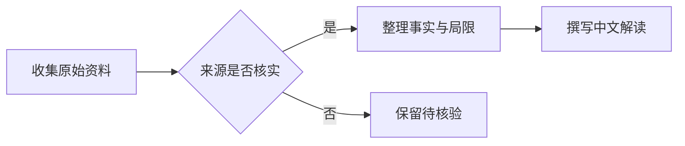
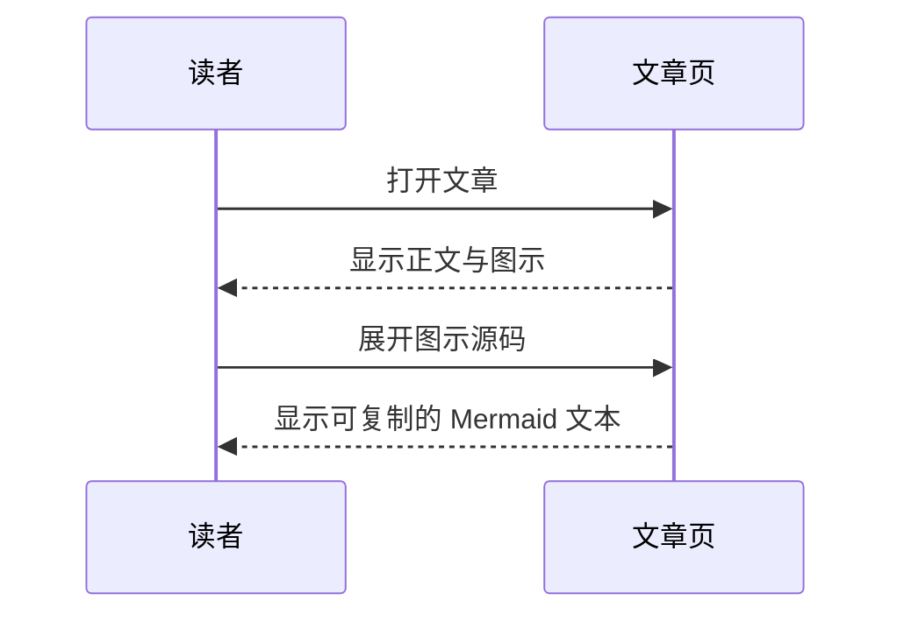

# 文章排版示例

表格、代码和图示都可以放进文章。这一页使用演示内容，方便查看阅读效果。

## 表格

窄屏下，较宽的表格可以左右滑动。表头、对齐方式和行内代码会保留。

| 内容 | 适合说明什么 | 示例写法 | 阅读方式 |
| :--- | :--- | :--- | :--- |
| 表格 | 参数、条件和结果的比较 | `| 项目 | 说明 |` | 左右滑动查看完整列 |
| 代码块 | 接口调用和短小的实现片段 | 三个反引号加语言名称 | 高亮、复制、横向滚动 |
| Mermaid 图示 | 处理顺序和模块关系 | `mermaid` 代码围栏 | 放大查看，也可展开源码 |

## 代码块

代码会保留缩进和空行。复制按钮复制的是完整源码，不会带上高亮标签。

```javascript
const article = {
  title: "文章示例",
  formats: ["table", "code", "mermaid"],
};

console.log(article.formats.join(" / "));
```

```python
def reading_minutes(characters: int) -> int:
    """演示函数：按每分钟300字估算。"""
    return max(1, (characters + 299) // 300)

print(reading_minutes(4700))
```

## 流程图

图示由源码生成。屏幕较小时可以点“放大查看”，再缩放或滚动阅读。



## 时序图



如果浏览器关闭了 JavaScript，表格和代码仍然可以阅读，图示会保留为源码。
